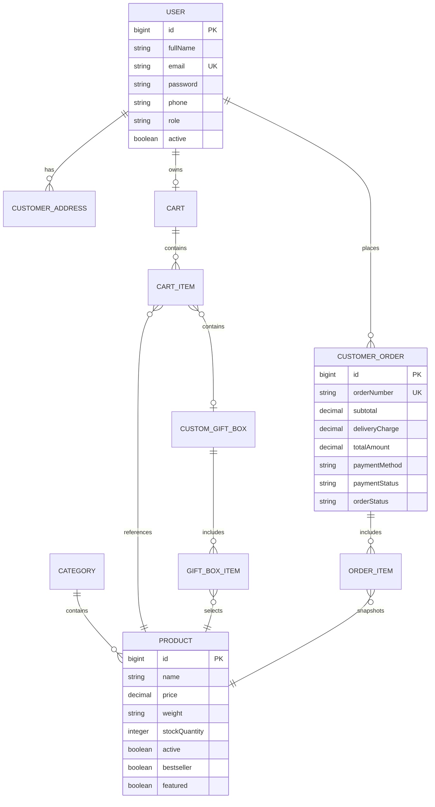

# 🍫 ChocoCraft – Homemade Chocolate E-Commerce Application

> *"Handmade with Love, Delivered with Happiness."*

ChocoCraft is a full-stack e-commerce platform built with **Java 17**, **Spring Boot 3.2**, **Spring Security**, **Spring Data JPA**, **Thymeleaf**, and **Bootstrap 5**. Designed specifically for artisanal homemade chocolates, it features custom chocolate gift box building, dynamic pricing, real-time inventory locking, customer order tracking, role-based authorization, and an administrative management dashboard.

---

## 🌟 Key Features

### 🛒 Customer Storefront
- **Dynamic Homepage**: Hero banner, bestsellers grid, category highlights, handmade quality promises, customer testimonials, and newsletter subscription.
- **Advanced Shop Catalog**: Browse products with live text search, category filtering, price range min/max sliders, and multi-attribute sorting (price low-high/high-low, rating, newest).
- **Product Details**: Comprehensive view including price, available pack size/weight, ingredients, allergen warnings, storage instructions, stock availability badges, and related chocolate recommendations.
- **Interactive Gift Box Builder**: Custom gift hamper generator allowing customers to:
  1. Pick a box size (**Small**: 4 pieces, **Medium**: 8 pieces, **Large**: 12 pieces).
  2. Select chocolate varieties with visual capacity progress indicators.
  3. Add a personalized gift message printed on a luxury card.
  4. Dynamically calculate price (`Base Box Fee + Selected Chocolates`).
- **Shopping Cart**: Real-time quantity adjustment, item removal, free delivery threshold indicator (e.g. Free shipping on orders $\ge$ ₹499), and server-side stock validation.
- **Checkout & Order Placement**: Address collection, order summary recalculation, Cash on Delivery (COD) or Mock Online Payment (UPI/Card simulation), and database concurrency-safe stock updates.
- **Customer Authentication**: Secure registration, session-based login with BCrypt password hashing, profile management, and order history.
- **Order Tracking**: Visual 5-step progress stepper (**Placed** $\rightarrow$ **Confirmed** $\rightarrow$ **Preparing** $\rightarrow$ **Shipped** $\rightarrow$ **Delivered** / **Cancelled**) with customer self-service order cancellation and automatic inventory restoration.

### 🛡️ Administrative Dashboard (`/admin/**`)
- **Metrics Overview**: Real-time KPIs for Total Sales Revenue (₹), Total Orders, Pending Orders, Completed Orders, Low-Stock Warnings, and Recent Orders feed.
- **Product Management**: Create, edit, activate/deactivate, set prices, assign categories, upload image URLs, and soft-delete products safely.
- **Category Management**: Create and manage chocolate categories.
- **Order Management**: View all customer orders, filter by status, inspect item snapshots, and update delivery status.
- **Inventory Control**: Live stock quantity monitoring with instant inline updates and low-stock alerts ($<10$ units).
- **Customer Management**: Read-only listing of registered customers with masked passwords.
- **Customer Inquiries**: Manage submitted contact messages.

---

## 📐 Database Architecture & Entity Relationship Diagram (ERD)



---

## 🛠️ Technology Stack

| Layer | Technology |
|---|---|
| **Language & SDK** | Java 17 (OpenJDK LTS) |
| **Framework** | Spring Boot 3.2.3 |
| **Security** | Spring Security 6 (BCrypt Password Hashing, Session Management) |
| **Persistence** | Spring Data JPA / Hibernate ORM |
| **Template Engine** | Thymeleaf + Thymeleaf Extras Spring Security |
| **Frontend UI** | HTML5, CSS3, JavaScript (ES6+), Bootstrap 5, FontAwesome 6 |
| **Database** | MySQL 8.x (with out-of-the-box H2 fallback in MySQL mode) |
| **Build Tool** | Apache Maven 3.9+ |
| **Testing** | JUnit 5, Mockito, Spring Security Test, Spring Boot Test |

---

## ⚙️ Setup & Execution Instructions

### 1. Prerequisites
- **Java**: JDK 17 or compatible.
- **Maven**: Installed in PATH or using bundled binary.
- **Database**: MySQL 8.0 server (optional, default runs seamlessly on embedded H2 in MySQL mode).

### 2. Environment Variables Configuration (Optional for Production MySQL)
Set the following environment variables if connecting to a standalone MySQL instance:

```bash
# Windows PowerShell
$env:SPRING_DATASOURCE_URL="jdbc:mysql://localhost:3306/chococraftdb?createDatabaseIfNotExist=true&useSSL=false&serverTimezone=UTC"
$env:SPRING_DATASOURCE_USERNAME="root"
$env:SPRING_DATASOURCE_PASSWORD="your_mysql_password"
$env:SPRING_DATASOURCE_DRIVER="com.mysql.cj.jdbc.Driver"
$env:SPRING_JPA_DIALECT="org.hibernate.dialect.MySQLDialect"
```

### 3. Application Startup
Run the application using Maven:

```bash
mvn clean spring-boot:run
```

Once started, open your browser and navigate to:
👉 `http://localhost:8080`

### 4. Running Automated Tests
Run unit and integration test suites:

```bash
mvn clean test
```

---

## 🔑 Demo Account Credentials

The application initializes default accounts upon startup for evaluation:

| Role | Email | Password | Access Rights |
|---|---|---|---|
| **Customer** | `customer@chococraft.com` | `Customer@123` | Storefront, Custom Gift Box, Cart, Checkout, Order Tracking |
| **Administrator** | `admin@chococraft.com` | `Admin@123` | Full Access + Admin Portal (`/admin/dashboard`) |

---

## 🛡️ Security Implementation
- **BCrypt Password Hashing**: Passwords are securely hashed before persisting.
- **Role-Based Authorization**: Routes starting with `/admin/**` are strictly guarded by `hasRole('ADMIN')` on the backend.
- **CSRF Protection**: All state-changing HTML forms incorporate CSRF tokens.
- **Backend Price & Inventory Recalculation**: Prices and item totals are calculated strictly using backend database records, never trusting raw browser values.

---

## 📄 License & Credits
Developed for **ChocoCraft**. Created with Spring Boot & Thymeleaf.
